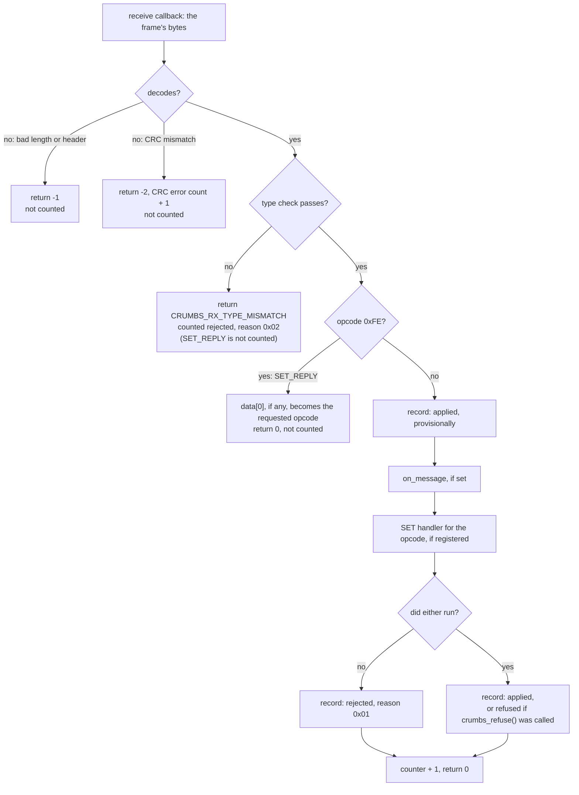
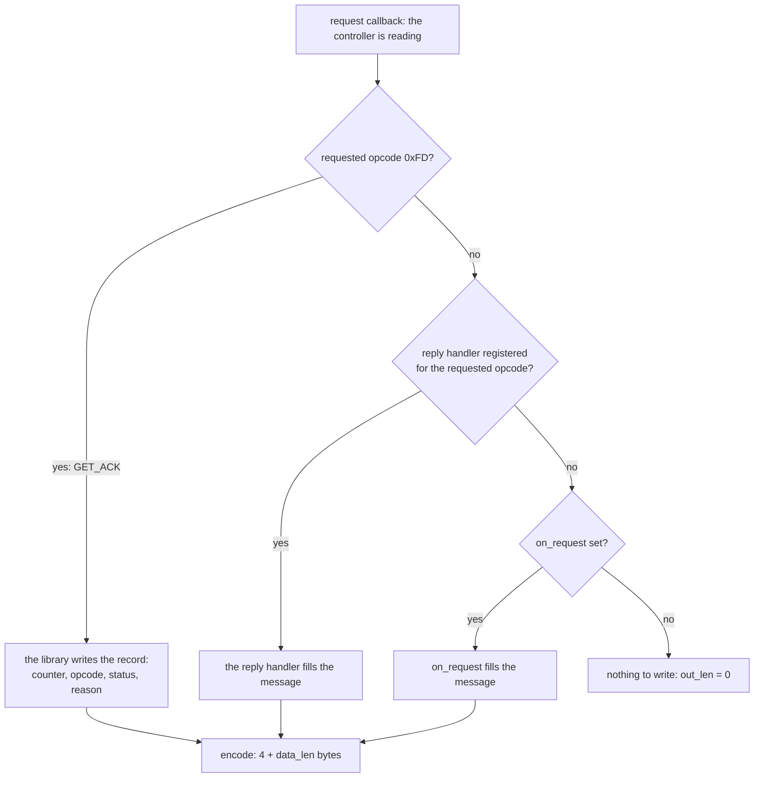
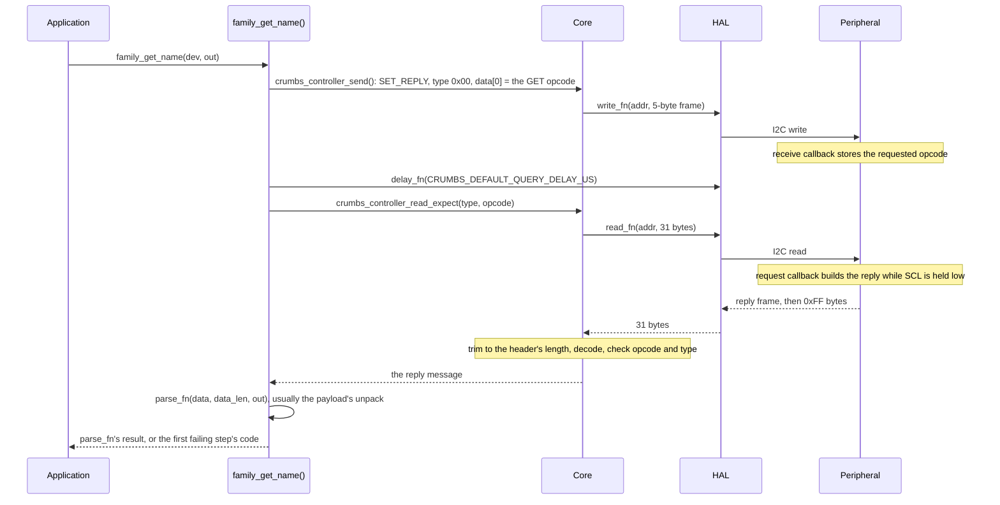
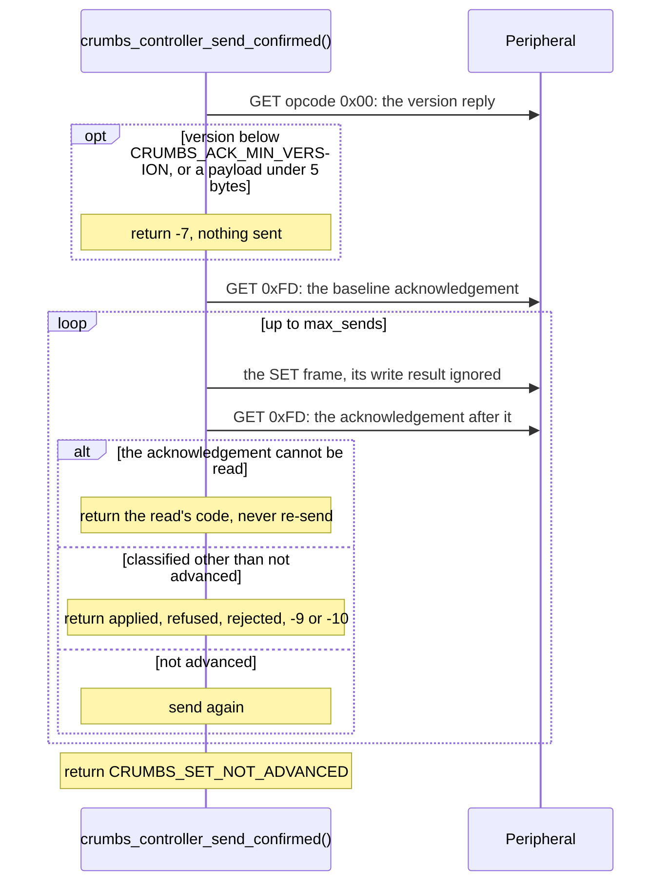
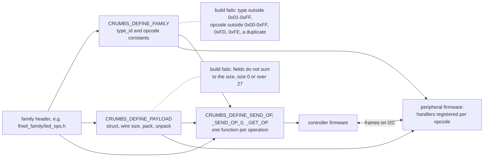

# Architecture

CRUMBS is a small C library that puts framed, CRC-checked messages on an I²C
bus between one controller and any number of peripherals. It owns framing,
validation and dispatch; the meaning of a message belongs to a *family* header
that both sides compile against. The wire format is in [protocol.md](protocol.md).

It is built to fit an ATmega328P beside real application code (no heap, one
static context, a 31-byte frame sized to the AVR `Wire` buffer), and its core
is plain C11 with no platform includes, so it is tested on the host and
compiled unchanged for Arduino and Linux. Deferred and rejected directions are
in [roadmap.md](roadmap.md).

## Layers

```text
 application / family header      what a type_id, opcode and payload mean
 ─────────────────────────────────────────────────────────────────────────
 crumbs_ops.h                     family identity, payload codecs, generated wrappers
 crumbs.h  crumbs_message_helpers.h   core: encode, decode, dispatch, scan
 ─────────────────────────────────────────────────────────────────────────
 crumbs_arduino.h  crumbs_linux.h HAL: put bytes on the bus, run callbacks
 ─────────────────────────────────────────────────────────────────────────
 Wire (Arduino)   linux-wire → i2c-dev (Linux)
```

| Layer | Files | Depends on |
| --- | --- | --- |
| Core | `src/core/crumbs_core.c`, `src/core/crumbs_i2c_helpers.c`, `src/crc/*`, headers `crumbs.h`, `crumbs_message.h`, `crumbs_message_helpers.h`, `crumbs_crc.h`, `crumbs_i2c.h`, `crumbs_ops.h`, `crumbs_version.h` | C11 only |
| Arduino HAL | `crumbs_arduino.h`, `src/hal/arduino/crumbs_i2c_arduino.cpp` | `Arduino.h`, `Wire.h` |
| Linux HAL | `crumbs_linux.h`, `src/hal/linux/crumbs_i2c_linux.c` | linux-wire ≥ 0.1.3 |

The core never calls a platform function. Bus access reaches it as function
pointers (`crumbs_i2c_write_fn`, `crumbs_i2c_read_fn`, `crumbs_delay_fn`, …
in `crumbs_i2c.h`) that the HAL supplies and the application passes in — or
bundles once in a `crumbs_device_t`. The Linux HAL is controller-only; the
Arduino HAL provides both roles. Both HAL source files are compiled by every
Arduino build; the Linux file reduces to stubs off Linux.

## Roles and contexts

A `crumbs_context_t` is initialised for exactly one role and the role gates
every entry point: the receive and reply functions refuse a controller context,
the send and read functions refuse a peripheral one. The struct is the same
for both; a controller uses only the role and the CRC statistics in it. On Arduino the HAL
keeps a single static pointer to the context it serves, so one sketch drives
one bus in one role.

### Peripheral: receiving

`crumbs_peripheral_handle_receive()` runs, in this order, and stops at the
first failure:

1. Decode the frame: structure, then CRC. Structural failures return `-1`; a
   CRC mismatch returns `-2` and increments the CRC error counter.
2. Type check: if the peripheral has declared a type and the frame carries a
   different non-zero type, return `CRUMBS_RX_TYPE_MISMATCH`.
3. SET_REPLY intercept: opcode `0xFE` stores `data[0]` as the requested opcode
   and returns `0` without reaching user code.
4. `on_message`, if set.
5. The first SET handler registered for the opcode, if any.

Steps 4 and 5 both run for an ordinary frame; `on_message` sees every
non-`0xFE` frame, a handler sees only its opcode.

Every frame that gets past step 1, except SET_REPLY, is counted for the
acknowledgement ([GET_ACK](protocol.md#get_ack-0xfd-the-set-acknowledgement)):
a frame stopped at step 2 is recorded as rejected for its type; otherwise it is
recorded as applied while steps 4 and 5 run, as refused if either calls
`crumbs_refuse()`, and as rejected if neither exists. The counter moves after
the status is written. The record is five bytes in the context.



*`crumbs_peripheral_handle_receive()`. "Counted" is the acknowledgement's
counter ([GET_ACK](protocol.md#get_ack-0xfd-the-set-acknowledgement)).*

### Peripheral: replying

`crumbs_peripheral_build_reply()` is called by the HAL when the controller
reads:

0. The acknowledgement, if the requested opcode is `0xFD` (GET_ACK); built by
   the library, so nothing below runs.
1. The reply handler registered for the requested opcode, if any.
2. Otherwise `on_request`, if set.
3. Otherwise nothing is written (`out_len = 0`; the AVR `Wire` core then
   sends a single `0x00` on its own).

Whatever the handler leaves in the reply message is encoded — including an
untouched, all-zero message, which goes out as the 4-byte frame `00 00 00 00`.



*`crumbs_peripheral_build_reply()`. The requested opcode is whatever the last
SET_REPLY stored, `0x00` after initialisation.*

On AVR both entry points run inside the TWI interrupt: reception once the
controller's write ends, reply construction while the controller's read is held
off by clock stretching. A transfer that addresses the peripheral while reception
is still running is stretched too; where that stretch starts differs by core
([protocol.md](protocol.md#when-the-reply-is-built)).

Keep handlers short and avoid anything that waits on another interrupt.

### Controller

`crumbs_controller_send()` encodes and calls the write function; its return is
the HAL's, passed through. `crumbs_controller_read()` reads 31 bytes, trims to
the header-declared length and decodes; `crumbs_controller_read_expect()` adds
the reply-identity check. The generated `_get_` wrappers chain SET_REPLY →
`delay_fn(CRUMBS_DEFAULT_QUERY_DELAY_US)` → read-expect → parse.
`crumbs_controller_read_ack()` is that chain for GET_ACK, retried up to
`CRUMBS_ACK_READ_ATTEMPTS` times; `crumbs_controller_send_confirmed()` checks
the opcode `0x00` version reply against `CRUMBS_ACK_MIN_VERSION`, reads it,
sends, reads it again, and re-sends only while all four acknowledgement
bytes equal the baseline and the status is not none, up to its bound.



*A getter generated by `CRUMBS_DEFINE_GET_OP`. A failing step returns at
once; nothing is retried.*



*`crumbs_controller_send_confirmed()`. Each GET is staged with SET_REPLY and
read up to `CRUMBS_ACK_READ_ATTEMPTS` times; if the version reply or the
baseline cannot be read, it returns that code with nothing sent. A failed
write is not taken as a lost frame: the acknowledgement decides. The
classification is [GET_ACK](protocol.md#get_ack-0xfd-the-set-acknowledgement)'s.*

## The family contract

A family is one header shared by controller and peripheral firmware:

- a `type_id` and its opcodes, declared once with `CRUMBS_DEFINE_FAMILY`;
- one field list per payload layout, from which `CRUMBS_DEFINE_PAYLOAD`
  generates the struct, the wire size, and the `pack` and `unpack` both
  sides call;
- for the controller, one function per operation, generated with
  `CRUMBS_DEFINE_SEND_OP` / `CRUMBS_DEFINE_SEND_OP_0` / `CRUMBS_DEFINE_GET_OP`
  over a `crumbs_device_t` that binds context, address and bus functions.



*One header, compiled into both sides. Dotted lines are compile-time checks.*

What the compiler enforces: the type is `0x01`–`0xFF`; every opcode is
`0x00`–`0xFF`, not `0xFD` or `0xFE`, and distinct from the others (a duplicate would
otherwise make one `crumbs_register_handler` call silently replace another);
each payload's field list sums to the length declared beside it and fits in
27 bytes; and two sides that go through the generated codec read and write
the same bytes. What it does not: which code paths go through the codec — a
handler that indexes `data[]` by hand compiles just as well — and agreement
between sides built from different revisions of the header, which is what
the opcode `0x00` version reply is for. By design a controller build
understands one family's vocabulary. It can still share
the physical bus with devices that are not CRUMBS at all — the `crumbs_i2c_dev_*`
helpers exist for talking raw registers to those, and the mixed-bus examples
run CRUMBS peripherals beside Bosch and Atlas Scientific sensors.
[create-a-family.md](create-a-family.md) walks through building one;
`examples/families_usage/lhwit_family/` is the reference.

## Handler tables

Each peripheral context has two tables, SET handlers and reply handlers, of
`CRUMBS_MAX_HANDLERS` entries each (default 16), searched linearly. The
original design indexed a 256-entry table directly; on an ATmega328P that put
two 512-byte arrays in RAM for a device with four commands. A linear search
over 16 entries is noise beside the transaction that delivered the frame: the
smallest CRUMBS frame plus its address byte is 45 bit-times, 450 µs at 100 kHz.

Registering an opcode twice replaces the handler in place; registering with a
`NULL` function removes it. `CRUMBS_MAX_HANDLERS=0` compiles both tables out,
leaving `on_message` and `on_request` as the only dispatch.

**`CRUMBS_MAX_HANDLERS` sizes the context, so it must be identical in every
translation unit.** Arduino and PlatformIO compile the library separately from
the sketch; a `#define` in the sketch changes only the sketch's idea of the
struct, and the library then writes past the end of it. Set it with a build
flag (`build_flags = -DCRUMBS_MAX_HANDLERS=8`) and, on startup, check
`crumbs_context_size() == sizeof(crumbs_context_t)`, as `hello_peripheral` does.

## Memory

No allocation anywhere; every buffer is the caller's or on the stack.

`sizeof(crumbs_context_t)` by handler-table size, measured with each target's
compiler (ATmega328P: avr-gcc 7.3.0-atmel3.6.1-arduino7; Cortex-M0:
arm-none-eabi-gcc 14.2.1; x86-64: gcc 14.2.0):

| `CRUMBS_MAX_HANDLERS` | ATmega328P | Cortex-M0 | x86-64 |
| --- | --- | --- | --- |
| 16 (default) | 183 B | 324 B | 608 B |
| 8 | 103 B | 180 B | 336 B |
| 0 | 21 B | 32 B | 56 B |

`crumbs_message_t` is 31 bytes everywhere; `crumbs_device_t` is 11 bytes on
AVR. The receive and reply paths each keep one 31-byte frame and one message
on the stack.

Whole-program cost on an Arduino Uno (`arduino-cli compile --fqbn
arduino:avr:uno`, arduino:avr 1.8.8, sketches in `tests/footprint/`): the
minimal CRUMBS peripheral — init plus one reply handler, no Serial — is 3420 B
flash / 396 B RAM, against 2066 B / 232 B for the bare-`Wire` sketch of the
same shape. The library therefore costs about 1.35 KB of flash and 164 B of RAM
at the default table size, 148 B of flash and 5 B of RAM of it the SET
acknowledgement; with the tables compiled out the same sketch is
3022 B / 234 B (its handler registration then fails, so that figure is library
code and context only). The CRC is 112 B of flash and, on AVR, 16 B of RAM —
the 16-entry nibble table generated by pycrc is `const` without `PROGMEM`, so
avr-gcc copies it to RAM — chosen over the bit-serial and 256-entry variants
the generator can also produce.

## HAL contract

A HAL provides the bus functions the core's typedefs describe plus role
initialisation. What the two shipped HALs actually do differs in ways a
portable application should know:

| | Arduino | Linux |
| --- | --- | --- |
| Roles | controller and peripheral | controller only |
| Read of *n* bytes | `Wire.requestFrom`; `Wire` clamps *n* to `BUFFER_LENGTH` | `read()` on the i2c-dev fd via linux-wire |
| Repeated start (`write_then_read`) | `endTransmission(false)` + `requestFrom` | single `I2C_RDWR` ioctl |
| `timeout_us` | real poll deadline; `0` = return what is already buffered | stored by linux-wire, not enforced |
| Address scanner, strict | one-byte read | one-byte read; driver-owned address counts as present |
| Address scanner, non-strict | address-only write (`endTransmission`) | SMBus Quick Write via `lw_probe()`; `-2` if the adapter cannot |
| Scanner count | keeps counting past `max_found` | stops at `max_found` |
| Clock | `Wire.setClock(100 kHz)` on AVR only (`CRUMBS_DEFAULT_TWI_FREQ`) | adapter's |

Bytes beyond a reply frame read as `0xFF` on both; the core trims before
decoding.

## Discovery

The two probes are in [protocol.md](protocol.md#discovery). A controller that
knows its family's addresses should use
`crumbs_controller_scan_for_crumbs_candidates()` rather than a range sweep: a
full-range scan touches every device on the bus.

## Debug output

`CRUMBS_DEBUG` enables `CRUMBS_DBG()` in the core, routed through
`CRUMBS_DEBUG_PRINT(fmt, ...)`, which the application defines. On Arduino,
defining `CRUMBS_DEBUG` *without* `CRUMBS_DEBUG_PRINT` instead turns on the
HAL's own `Serial` tracing; defining both leaves only the core path. Neither
opens `Serial`.
